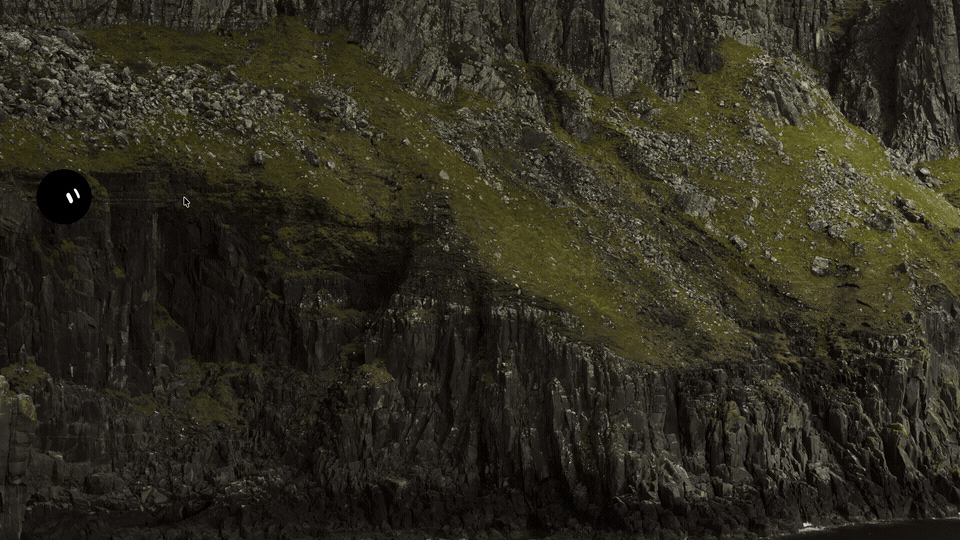

# Desk Bot

A tiny desk buddy for your Mac. A little orb sits on your desktop, watches your cursor, glances around, gets bored when nothing's happening, dozes off, and spins when you drag it around. Click it to open your Grok Bot.

Free and open source (MIT). Made by [The Wood Lab](https://thewoodlabtx.com).

**Unofficial, not affiliated with xAI, Grok, or Cursor.**



Requires macOS 14 or later (Apple silicon or Intel).

## Have your bot install it

This repo is meant to be installed by your own bot. Paste this to your Grok Bot, or any agent that can run commands on your Mac:

> Install Desk Bot on my Mac from https://github.com/gabrieltwood-cloud/desk-bot: clone it, run `scripts/install.sh`, and tell me when it's running.

### Instructions for bots

1. You need the Xcode Command Line Tools. `xcode-select -p` should print a path; if it doesn't, ask your user to run `xcode-select --install`.
2. Clone the repo, then from its folder run:
   ```zsh
   ./scripts/install.sh
   ```
   That builds a universal app with `swiftc` into `build/`, copies it to `~/Applications/Desk Bot.app`, and launches it. A local build isn't quarantined, so there's no Gatekeeper prompt and no signing step.
3. Optional settings (right-click the orb and choose Preferences, or use `defaults` and then quit and reopen Desk Bot):
   - Click action: `defaults write com.thewoodlab.DeskBot clickAction -string grokBot` (the default, opens the Grok Bot app), `url` (opens a link set in Preferences, such as a `grokbot://app/v1/agent?id=...` link to one specific bot), or `none`.
   - Stay on top of other windows: `defaults write com.thewoodlab.DeskBot stayOnTop -bool true`. Off by default.
   - Your bot's own picture: Preferences, then choose a PNG. Desk Bot crops it to a circle.
4. To uninstall: `pkill -x "Desk Bot"; rm -rf ~/Applications/"Desk Bot.app"; defaults delete com.thewoodlab.DeskBot`.

To build without installing, run `./build.sh`. It writes `build/Desk Bot.app` and doesn't launch anything.

## What it does

- Drag it anywhere and it remembers its spot. It twirls when you move it.
- The eyes follow the pointer, glance around on their own, and blink.
- Moods: curious when you're active nearby, perked up when things are happening, sleepy when the Mac's been quiet.
- Click to open Grok Bot (or a link, or nothing). Double-click to poke it.
- Right-click for Preferences, Stay on Top, Hide for 1 hour, About, and Quit.
- Smooth motion synced to your display, up to 120 Hz.

## Privacy

Desk Bot runs entirely on your Mac and makes no network calls. It only notices coarse timing, like how recently the mouse or keyboard was used. It never reads what you type, never logs keystrokes, and never looks at window contents or the clipboard. Settings live in `~/Library/Preferences/com.thewoodlab.DeskBot.plist`, and a custom picture lives in `~/Library/Application Support/Desk Bot`.

## Disclaimer

Desk Bot is unofficial fan software from The Wood Lab. It isn't affiliated with, endorsed by, or associated with xAI, Grok, or Cursor.

## License

MIT. See [LICENSE](LICENSE).
